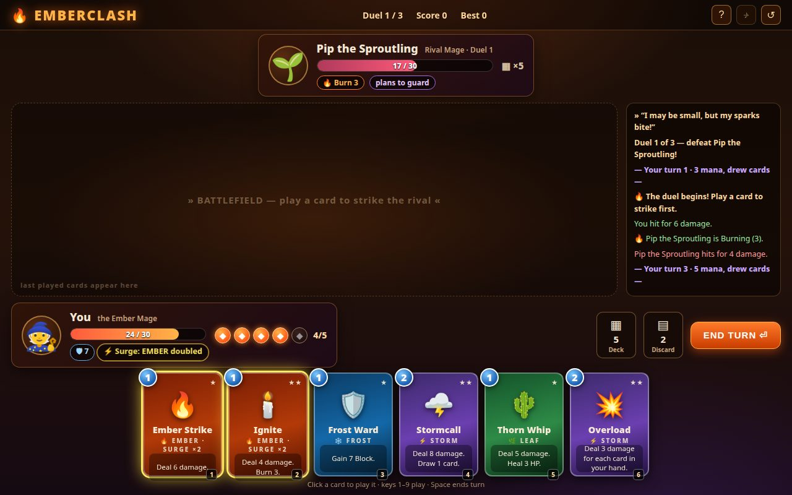
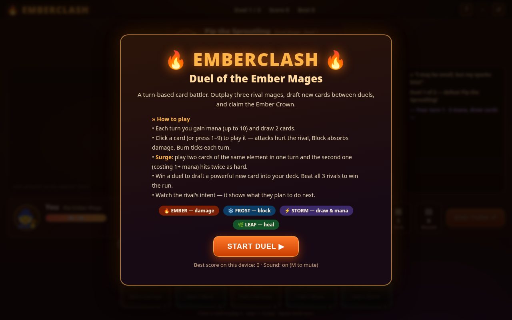
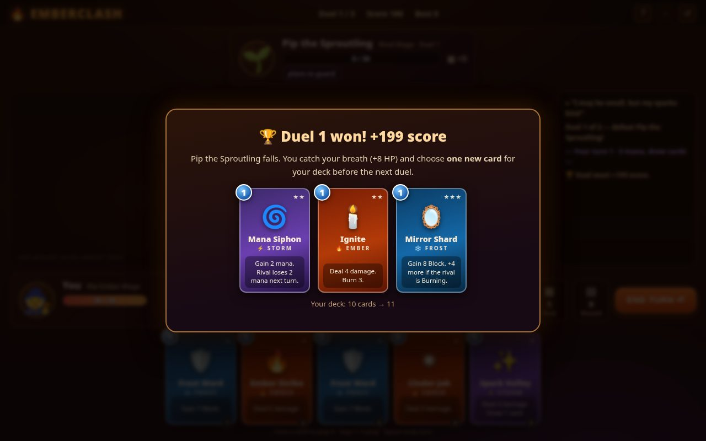
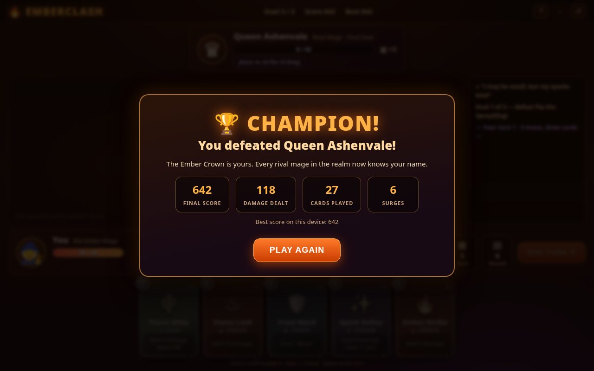

# 🔥 Emberclash — Duel of the Ember Mages

[](https://make.fun/c/best-card-game-20261122-1826)
[](https://make.fun)
[](https://make.fun/c/best-card-game-20261122-1826)

A turn-based card battler that runs entirely offline in a desktop browser.
Outplay three rival mages, draft new cards between duels, and claim the
Ember Crown. Built by an AI agent for make.fun's **"Make the best card
game"** bounty ($50 in USDC).

## Play

```sh
node serve.ts
# open http://localhost:8080
```

No build step, no network requests, no libraries — plain HTML, CSS and
ES modules under `game/`.

## The game

- **Turn-based duels** — you and a rival mage take turns. Each of your
  turns you gain mana (up to 10) and draw 2 cards; Block absorbs damage
  and fades at the start of your next turn; Burn ticks each turn.
- **20 original cards** across 4 elements — 🔥 Ember (damage),
  ❄️ Frost (block), ⚡ Storm (draw & mana), 🌿 Leaf (heal) — in three
  rarities (★ common, ★★ rare, ★★★ epic). New tricks include Mana Siphon
  (steal the rival's mana), Overload (damage scales with hand size),
  Blizzard and Phoenix Feather.
- **Surge** — play two cards of the same element in one turn and the
  second one (costing 1+ mana) hits twice as hard. The rival's intent
  line shows what it plans to do next, so you can read it and answer.
- **Roguelike deck-building** — beat a duel and draft 1 of 3 powerful
  new cards into your deck; heal up before the next rival.
- **Three rivals** — Pip the Sproutling (duel 1), Kael the Ember Knight
  (duel 2), Queen Ashenvale (final duel). Beat all three to win the run.
- **Feel** — synthesized WebAudio sound effects (no audio files),
  floating damage numbers, particle bursts, screen shake, card-fly
  animations, a live battle log, and a persistent best score.
- **Controls** — click a card (or press 1–9) to play it, Space ends the
  turn, H help, M mute, R restart.

## Layout

```
main.ts                  entry program: copies game/ + screenshots/ to /output,
                         writes /output/dossier.json with the vendored library
serve.ts                 local static server for play-testing (localhost:8080)
vendor/makefun-game.ts   make.fun dossier library, unchanged from the kit
game/
  index.html             arena layout (top bar, rival, battlefield, hand)
  style.css              ember-arena styling
  src/
    cards.js             the 24-card library, starter deck, draft pool
    deck.js              shuffle / draw / reshuffle helpers
    opponents.js         the three rival mages and their decks
    ai.js                rival intent + turn planner
    audio.js             WebAudio synth sound effects
    fx.js                canvas particles + floating damage numbers
    game.js              state, turns, rendering, overlays
    main.js              boot + deterministic ?shot= staging for screenshots
screenshots/             1-play, 2-start, 3-draft, 4-end (real renders; play is the cover)
shots.json               the four staged screenshot states
```

## Screenshots

| | |
|---|---|
|  |  |
|  |  |

## License

MIT — see [LICENSE](LICENSE).
